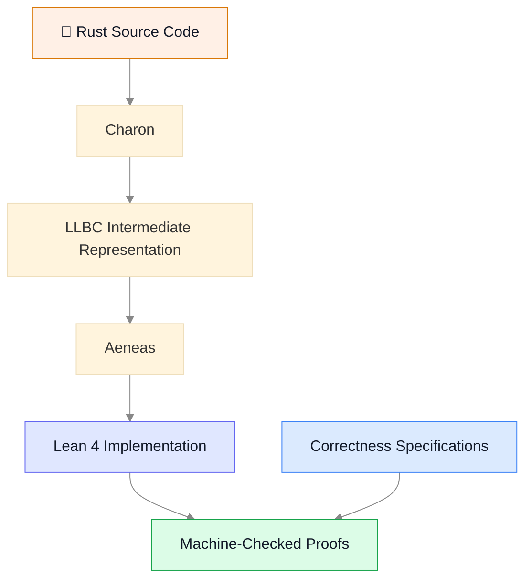
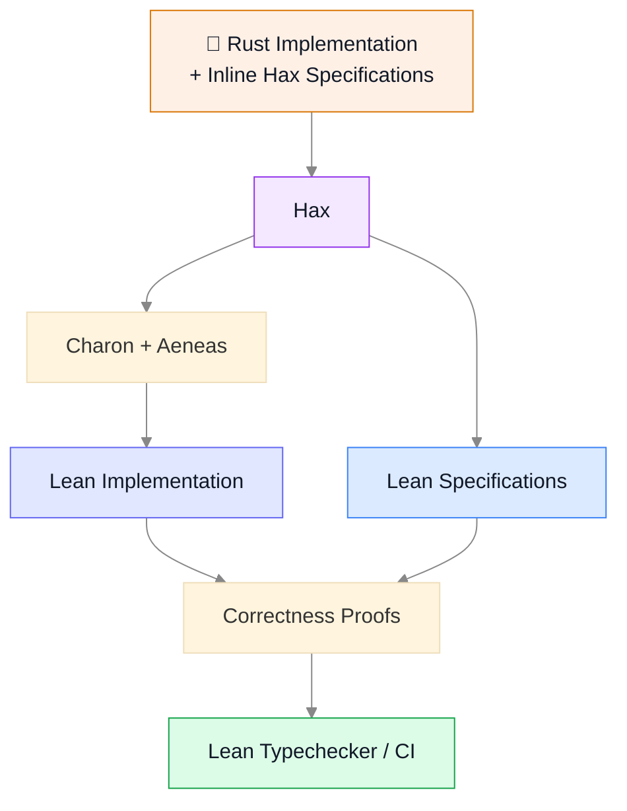

# LeanVM Formal Verification Roadmap

[see hackmd here](https://hackmd.io/4HAyyjmDTuSCa6kvK4YrKA?view)

## Status

Stage 1 is in place for every crate in `crates/`. [`formal/extraction/README.md`](formal/extraction/README.md) describes how it works and how to keep it current, and [`formal/extraction/LIMITATIONS.md`](formal/extraction/LIMITATIONS.md) what the extractions leave out and why.

- hax's Lean backend extracts each crate into a Lean package beside it, `crates/<crate>/proofs/<scenario>/lean`, and every extraction typechecks, with no `sorry`. They share their Lean dependencies through one workspace, `formal/extraction`.
- Each crate's `hax.toml` lists what is left opaque, grouped by what stops it, so it is also the list of what remains to extract. The arithmetic, hashing, transcripts, signature schemes and most of the verifier's building blocks are extracted with their bodies; concurrency, `unsafe`, the SIMD kernels and the top-level loops of verification and proving are opaque for now.
- The extraction is of the portable code paths, the same on every host: the hardware features the crates dispatch on are switched off while extracting.
- Rust the toolchain cannot translate is rewritten by small patches applied only while extracting. The committed source is never patched, and CI runs each patched crate's tests, including checks against real proofs, on the patched source.
- CI fails when a committed extraction no longer matches the Rust, when one no longer typechecks, or when the patched source fails its tests. Every run reports what each extraction trusts: opaque items, untranslated bodies, patches, and the shared standard-library models.

Stage 2 has begun with the native verifier, whose proofs live in `crates/verifier/proofs/verifier/lean/Verifier/Verification/` and are built with every extraction. They show that the extracted field arithmetic is CompPoly's `BF64` and its cubic extension `Ext3`, that `Scaled`, the table the verifier multiplies a fixed factor through, computes the product (`scaled_mul`), that `eq_kernel` computes ArkLib's `multilinearWeight` at points of up to 31 coordinates, and that the verifier's WHIR fold of a queried row is ArkLib's `multilinearCombine` of the row's lanes, at level 0 (`level0_fold`) and at every deeper level (`deeper_fold`), resting on no opaque item's assumption.

## Introduction

Every day, LLMs become more capable of finding and exploiting vulnerabilities in software. However, for those of us shipping production, security-critical code, LLMs can be an equally (if not more) powerful defensive tool. In order to ship secure software moving forward, **we must establish a culture of formally verifying our production codebases**. Formal verification should complement existing security tools and measures, not replace them.

To formally verify Rust codebases, we use a Rust-to-Lean translation pipeline to extract the source code into a functional representation whose behavior matches the original source code. We formally verify the resulting Lean code against mathematical specifications, leveraging existing formal specifications like [Arklib](https://github.com/Verified-zkEVM/ArkLib) and [verified-zkEVM ecosystem](https://verified-zkevm.org).

This document outlines a three-stage roadmap for introducing formal verification into LeanVM, progressing from extraction infrastructure to machine-checked correctness proofs and, ultimately, production hardening.

---

## Rust to Lean Translation

The central idea for formally verifying LeanVM is straightforward: **translate the production Rust code into Lean, specify its intended behavior, and mathematically prove that the implementation satisfies its specification.** To accomplish this, we will use [Hax](https://hax.cryspen.com/), which builds on the [Charon](https://github.com/AeneasVerif/charon) and [Aeneas](https://github.com/AeneasVerif/aeneas) toolchain to provide an integrated developer experience of formal verification in Rust.

### Charon and Aeneas: the Translation Engine

[Charon](https://github.com/AeneasVerif/charon) and [Aeneas](https://github.com/AeneasVerif/aeneas) provide the underlying Rust-to-Lean translation infrastructure.

- **Charon** extracts Rust code into an intermediate representation (LLBC), preserving the structure and semantics needed for verification.
- **Aeneas** translates this representation into functional Lean code, leveraging Rust's ownership and borrowing discipline to simplify reasoning about memory.



The key advantage of Aeneas is that it translates Rust into a functional representation that is much easier to reason about mathematically. In particular, it exploits Rust's ownership guarantees to avoid much of the complexity associated with reasoning directly about mutable memory.

**Further reading:**

- [Charon on GitHub](https://github.com/AeneasVerif/charon)
- [Aeneas on GitHub](https://github.com/AeneasVerif/aeneas)
- [Aeneas: From Rust to Your First Lean Proof](https://github.com/AeneasVerif/aeneas/blob/main/documentation/getting-started.md)

### Hax: Bringing Specifications into Rust

[Hax](https://hax.cryspen.com/) builds on this infrastructure, **providing a more integrated developer experience**.

In particular, Hax allows developers to **write formal specifications directly alongside their Rust implementations**, rather than maintaining separate specifications in Lean.

For example:

```rust
#[hax_lib::requires(x < 100)]
#[hax_lib::ensures(|result| result > x)]
fn increment(x: u32) -> u32 {
    x + 1
}
```

Here, the developer has specified two properties:

- `requires`: The function expects `x < 100`.
- `ensures`: The function guarantees that its result is greater than `x`.

These annotations do not change the behavior of the production Rust implementation. Instead, Hax extracts them into Lean, where we can prove that the implementation satisfies its specification.

With Hax 0.4's Lean backend, the complete workflow looks like this:



This approach has several important advantages:

- **Single source of truth:** Specifications live alongside the Rust code they describe.
- **Incremental verification:** Developers can introduce specifications and proofs gradually.
- **CI integration:** Changes to verified Rust code can trigger extraction and proof checking automatically.
- **Developer accessibility:** Formal verification becomes part of the existing Rust development workflow.

The result is a practical path toward making formal verification a routine part of developing and maintaining LeanVM.

**Further reading:**

- [Hax, official website](https://hax.cryspen.com/)
- [Hax 0.4: New Lean Backend](https://hax.cryspen.com/blog/2026/09/29/hax-04-easier-to-install-and-configure-and-a-new-lean-backend/)
- [Hax specification annotations, API documentation](https://docs.rs/hax-lib/latest/hax_lib/)
- [Hax Lean Tutorial: Specifying Panic Freedom](https://hax.cryspen.com/manual/lean/tutorial/panic-freedom/)

### Hax in Production

Verifying production Rust with Hax is a trodden path. Most deployed results so far use Hax's more mature F* backend; the Lean backend applies the same extraction and annotation model and is under active development.

- **[libcrux ML-KEM](https://cryspen.com/post/ml-kem-verification/)** (Cryspen): a post-quantum KEM written in Rust with portable, AVX2 and NEON implementations, verified with Hax for panic freedom, functional correctness and secret independence. A C build of the verified code [ships in Mozilla's NSS](https://arai.searchfox.org/firefox-main/source/security/nss/lib/freebl/verified/libcrux_mlkem768_portable.c), and therefore in Firefox.
- **[Signal's Sparse Post-Quantum Ratchet (SPQR)](https://signal.org/blog/spqr/)**: the Rust `spqr` crate behind Signal's Triple Ratchet, deployed in October 2025, is annotated with `hax-lib` and builds on libcrux's ML-KEM, HKDF and HMAC. Cryspen [verified the deployed implementation](https://cryspen.com/post/signal-spqr-verification/) alongside a ProVerif analysis of the protocol design.
- **[Verifying a real-world Rust crate](https://hax.cryspen.com/blog/2026/01/19/verifying-a-real-world-rust-crate/)** (Hax blog, January 2026): an end-to-end walkthrough of applying Hax to an existing crate, including the proof obligations that needed manual effort.
- **[A Rust-to-Lean Verification Pipeline with AI Provers](https://arxiv.org/abs/2605.30106)** (May 2026): an experience report on extracting production Rust cryptographic code to Lean 4 with Hax and Aeneas and proving it correct, including the practical friction (toolchain drift, extraction gaps) we should expect in Stage 1.

---

# Roadmap

We have a three-stage roadmap:

1. Hax extraction
2. Formal Verification
3. Pre-Deployment Hardening

## Stage 1: Hax Extraction


**Goal:** Establish a reliable Rust-to-Lean extraction pipeline, integrated into CI, that keeps LeanVM's Lean representation synchronized with its Rust implementation.


The first stage focuses on building the infrastructure necessary for formal verification, without requiring correctness proofs. We will use [Hax](https://github.com/cryspen/hax) to extract Lean representations of LeanVM's Rust code, providing a foundation on which specifications and proofs can subsequently be developed.

### Implementation

1. **Establish Hax extraction.** Configure Hax to extract the relevant LeanVM modules into Lean, resolving unsupported Rust constructs and extraction issues as necessary. We will prioritize ***native extraction***: minimizing modifications to the original Rust codebase and avoiding the need to maintain a separate verification-oriented implementation.
2. **Integrate extraction into CI.** Automate the extraction process and ensure that the generated Lean code compiles successfully. CI should detect when changes to the Rust implementation break extraction or Lean typechecking, keeping the two representations synchronized.
3. **Enable inline specifications.** Establish conventions for writing formal specifications directly alongside Rust implementations using [Hax's annotation mechanisms](https://docs.rs/hax-lib/latest/hax_lib/) (see also the [Lean tutorial](https://hax.cryspen.com/manual/lean/tutorial/panic-freedom/)). This allows developers to introduce specifications incrementally, without maintaining separate specification files.
4. **Maintain a permissive proof policy.** At this stage, correctness proofs are not required. Unproven theorems may freely contain `sorry`; the only requirement is that the extracted Lean code successfully typechecks.

### Deliverables

By the end of Stage 1, we will have:

- A reproducible Hax extraction pipeline covering an agreed-upon subset of LeanVM which is flexible to evolve with changes to the LeanVM codebase.
- CI checks ensuring that extracted Lean code remains current and typechecks.
- Infrastructure supporting inline specifications and future correctness proofs.
- Documentation enabling LeanVM developers to maintain and extend the extraction pipeline.

**Success criterion:** Changes to the supported Rust code can be automatically reflected in Lean, with CI detecting extraction or typechecking regressions, without requiring developers to discharge formal proof obligations.

### Ownership

Initially, the formal verification team, lead by [Derek](https://github.com/dhsorens), will take primary responsibility for maintaining the extraction infrastructure, resolving compatibility issues, and supporting LeanVM developers. As the pipeline matures, maintenance should become increasingly automated and require progressively less specialized involvement.

---

## Stage 2: Formal Verification


**Goal:** Incrementally establish machine-checked correctness guarantees for LeanVM, prioritizing security-critical components and progressively strengthening proof requirements.


With the extraction infrastructure established, we can begin formally verifying LeanVM against its intended specifications. Verification will proceed incrementally, prioritizing stable components where correctness guarantees provide the greatest value. We will leverage [Arklib](https://github.com/Verified-zkEVM/ArkLib) and the broader Lean verification ecosystem wherever possible.

### Implementation

1. **Define correctness specifications.** Identify the key correctness properties of LeanVM's components, prioritizing security-critical functionality. Where appropriate, specifications should be written inline in Rust using Hax's annotation mechanisms, allowing them to evolve alongside the implementation.
2. **Develop correctness proofs.** Prove that the extracted Lean implementations satisfy their specifications, using Arklib and related proof infrastructure where applicable. Initially, focus on stable, self-contained components, expanding verification coverage as the codebase matures.
3. **Integrate proof checking into CI.** Automatically check correctness proofs alongside extraction and typechecking. Changes to verified components must preserve their established guarantees, with proof failures treated as CI failures.
4. **Progressively restrict** `sorry`**.** Initially permit incomplete proofs to facilitate development, but establish increasingly strict policies as verification coverage grows. In particular, prohibit new `sorry` occurrences in fully verified components, and progressively eliminate existing ones.
5. **Track verification coverage.** Maintain a clear record of which components and properties have been formally verified, which remain incomplete, and which assumptions or axioms are relied upon. This provides visibility into progress and prevents overstating the guarantees established.

### Deliverables

By the end of Stage 2, we will have:

- Machine-checked correctness proofs for an agreed-upon set of security-critical LeanVM components.
- CI checks enforcing the preservation of established correctness guarantees.
- A progressively stricter `sorry` policy, preventing regressions in verified components.
- Documented verification coverage, including outstanding proof obligations and trusted assumptions.

**Success criterion:** An expanding subset of LeanVM is formally verified against explicit correctness specifications, with CI ensuring that subsequent implementation changes cannot silently invalidate established proofs.

### Ownership

The formal verification team, lead by [Derek](https://github.com/dhsorens), will initially lead specification development and proof construction, working closely with LeanVM developers to identify appropriate correctness properties. Over time, developers should increasingly participate in maintaining proofs alongside implementation changes, with the verification team providing specialized support.

---

## Stage 3: Pre-Deployment Hardening

**Goal:** Strengthen the connection between formal correctness proofs and production LeanVM implementations, minimizing unverified assumptions and establishing confidence in the end-to-end verification guarantees.

While Stages 1 and 2 establish the extraction infrastructure and correctness proofs, these guarantees depend on the soundness of the extraction pipeline and the correspondence between verified Lean code and deployed Rust implementations. The final stage focuses on identifying and addressing these remaining gaps, ensuring that formal verification provides meaningful assurances about the production system.

### Implementation

1. **Audit and minimize extraction patches.** When necessary, we may have to patch the source Rust code to enable extraction. We will identify and review all such modifications to the original Rust code required to support Hax extraction. We minimize these modifications wherever possible, prioritizing improvements to Hax and its dependencies that enable more Rust constructs to be extracted natively. Where patches remain necessary, establish their correctness with rigorous testing, possibly including formal reasoning, or explicitly document the associated assumptions.
2. **Verify optimized implementations.** Address production code paths that cannot be extracted through Hax, particularly SIMD-optimized and architecture-specific implementations. Where appropriate, leverage [binary-level verification techniques](https://derekhsorensen.com/slides/verso/cambridge-2026/) to establish correctness directly against the compiled machine code, ensuring that optimized backends satisfy the same specifications as their verified counterparts.
3. **Review and strengthen specifications.** Systematically review the specifications developed during Stage 2, ensuring that they accurately capture the intended behavior and relevant security properties of LeanVM. Identify missing assumptions, underspecified behavior, and potential discrepancies between the formal specifications and production requirements.
4. **Audit the Trusted Computing Base (TCB).** Identify and document the assumptions and trusted components underlying the verification guarantees, including the extraction pipeline, compiler, runtime environment, and any external dependencies. Where practical, reduce the TCB or supplement formal proofs with independent validation techniques, such as differential testing and property-based testing.
5. **Establish deployment readiness criteria.** Define explicit requirements for considering a component sufficiently verified for production deployment, including proof completeness, specification coverage, outstanding assumptions, and any unverified implementation paths.

### Deliverables

By the end of Stage 3, we will have:

- An audited extraction pipeline with minimized and documented patches.
- Verification or independently validated correctness of critical optimized implementations, including SIMD backends.
- Reviewed and strengthened correctness specifications for verified components.
- A documented TCB, including outstanding assumptions and associated mitigations.
- Clear criteria for assessing the verification status of production LeanVM components.

**Success criterion:** The formal verification guarantees established in Stage 2 can be meaningfully connected to the production LeanVM implementation, with remaining assumptions, unsupported code paths, and limitations explicitly identified and appropriately mitigated.

### Ownership

The formal verification team, lead by [Derek](https://github.com/dhsorens), will lead the hardening process, working closely with LeanVM developers to audit extraction patches, assess optimized implementations, and review specifications. Where necessary, this work may involve contributions to upstream verification tooling and collaboration with external researchers.

## Conclusion

This roadmap establishes a practical, incremental path toward formally verifying LeanVM, with the long-term goal of making formal verification a routine part of developing and maintaining production code.

The three stages progressively strengthen our correctness guarantees:

1. **Stage 1, Hax Extraction:** Establish the infrastructure to automatically translate Rust into Lean, keeping the formal representation synchronized with the production codebase.
2. **Stage 2, Formal Verification:** Incrementally introduce correctness specifications and machine-checked proofs, ensuring that established guarantees are preserved as the code evolves.
3. **Stage 3, Pre-Deployment Hardening:** Strengthen the connection between formal proofs and production implementations, auditing assumptions, addressing optimized code paths, and minimizing the trusted computing base.

Crucially, **formal verification should become an ongoing development practice, not a one-time certification exercise**. By integrating extraction and proof checking into CI, we can ensure that verification coverage grows alongside the codebase, without imposing unreasonable burdens on developers.

Ultimately, the objective is not simply to prove LeanVM correct at a particular point in time, but to establish the infrastructure, tooling, and engineering culture necessary to **continuously maintain and strengthen its correctness guarantees throughout its lifetime**.